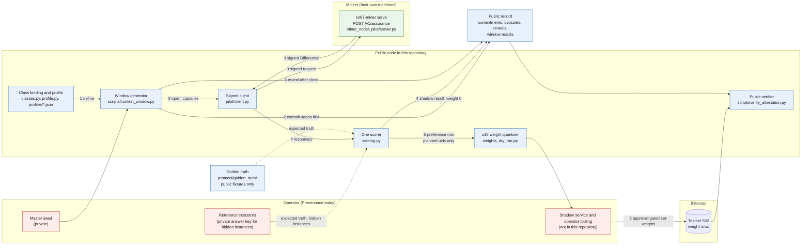

# Diagram 1: System architecture

> Who does what in SN87, and what moves between them. Numbers 1 to 6 match the six steps in the
> [README](../../README.md#how-it-works).

Quick links: [diagram index](README.md) | [glossary](../GLOSSARY.md) | [next: submission lifecycle](02-submission-lifecycle.md)

Red boxes are private. Blue boxes are public and can be read or run from this repository or its
published records. Green is the miner, which runs on the miner's own machine.

## What each step does

| Step | What happens | Code |
|---|---|---|
| 1. Define | A task family is a class binding: capsule and response validators, defect severities, a generator and a matched baseline. A committed profile fixes every scoring parameter. | `src/sn87_provenonce/classes.py`, `src/sn87_provenonce/profile.py`, `src/sn87_provenonce/profiles/` |
| 2. Commit | The operator publishes seed commitments for a whole schedule before any window opens. | `scripts/contest_window.py` (phase `commit`) |
| 3. Query | Capsules go to miners in signed requests. Each miner answers with one signed Differential. | `src/sn87_provenonce/pilot/client.py`, `src/sn87_provenonce/pilot/server.py` |
| 4. Score | The one scorer checks integrity, compares the answer with truth and scores it under the profile. A shadow result is published with weight 0. | `src/sn87_provenonce/scoring.py`, `docs/protocol/window-results.md` |
| 5. Weight | Only for uids named in an approved plan, a preference row is quantized to u16 weights and an operator sets them on testnet. | `src/sn87_provenonce/weights_dry_run.py`, `docs/protocol/admission.md` |
| 6. Reveal | After close, the seed is to be revealed so anyone can regenerate and check every capsule. The reveal for the first schedule is not yet published (ADR-0023). | `scripts/contest_window.py` (phases `reveal`, `verify`) |

## Read this with the limits

- The operator today is Provenonce. It builds the instances, holds the reference executors and
  runs the validator. The weighted uids 1 and 2 are operated by Provenonce too
  ([LIMITATIONS.md](../../LIMITATIONS.md), items 1 and 13).
- The shadow service and the operator tooling are not in this repository. This tree holds the
  contracts, the scorer, the generator and the checkers that consume their published output.
- Only the per-case truth of the committed public fixtures is public. Truth for hidden instances
  comes from the private executors.
- The seed reveal for the first schedule is not yet published
  ([ADR-0023](../architecture/ADR-0023-opening-block-seed-truth-commitment-and-reveal-deadline.md)).
- No outside miner is weighted today. See the [status table](../../README.md#current-status).
