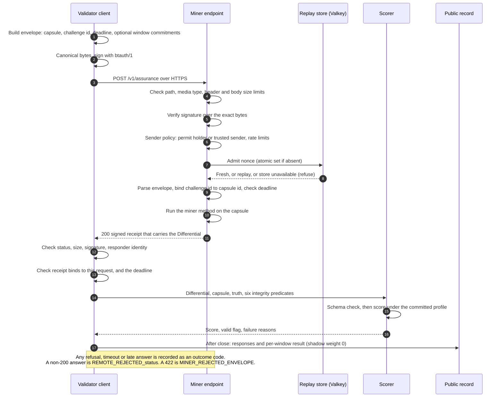

# Diagram 2: Submission lifecycle

> One capsule, from the signed request to a recorded score, and what each side checks on the way.

Quick links: [diagram index](README.md) | [miner guide](../guides/miner-guide.md) | [ADR-0005](../architecture/ADR-0005-signed-http-and-replay-boundary.md) | [previous](01-architecture.md) | [next: scoring pipeline](03-scoring-pipeline.md)

In SN87 a miner does not upload a file. The validator sends a capsule to the miner's HTTPS
endpoint, and the miner answers inside the same call. So a "submission" is one signed answer,
a `Differential`, per capsule.

## What each check is for

| Step | Check | Failure you see | Code |
|---|---|---|---|
| 4 | Request path, media type, size | `UNSUPPORTED_PATH`, `UNSUPPORTED_MEDIA_TYPE`, `BODY_TOO_LARGE` | `src/sn87_provenonce/pilot/server.py` |
| 5 | Signature over the exact received bytes | a 401 with a stable error code | `src/sn87_provenonce/pilot/transport.py` (`verify_bytes`) |
| 6 | Sender is a permit holder or a named trusted sender; rate limits | `SENDER_NOT_PERMITTED` (403), `SENDER_RATE_LIMITED` (429) | `src/sn87_provenonce/pilot/sender_policy.py` |
| 7 to 8 | Nonce not seen before; a store that cannot prove freshness refuses | `REPLAY_STORE_UNAVAILABLE` (503) | `src/sn87_provenonce/pilot/transport.py` (`SharedReplayStore`) |
| 9 | The envelope has the expected fields; the challenge id equals the capsule `qid`; the deadline is in the future and at most 15 seconds out | `INVALID_ENVELOPE`, `CHALLENGE_BINDING_FAILED`, `DEADLINE_REJECTED` | `src/sn87_provenonce/pilot/server.py` |
| 10 | The miner method runs and returns a Differential for the same `qid` | `HANDLER_BINDING_FAILED`, `DEADLINE_EXCEEDED` (raised by the server, not the method) | `src/sn87_provenonce/pilot/server.py`; the method itself is `src/sn87_provenonce/miner_node/core.py` |
| 12 to 13 | Client checks the response: size, signature, that the responder is the expected hotkey, that the receipt binds to the request bytes and nonce, and the deadline | `RESPONDER_IDENTITY_MISMATCH`, `RESPONSE_BINDING_FAILED`, `RESPONSE_LATE` | `src/sn87_provenonce/pilot/client.py` (`verify_response`) |
| 15 | The Differential matches the capsule and the schema | counted as invalid, score 0 | `src/sn87_provenonce/institutional_v02/contracts.py` (`validate_differential`), `src/sn87_provenonce/scoring.py` (`score_response`) |

Every error code, and what to do about it, is in the
[miner guide, Part G](../guides/miner-guide.md#part-g-troubleshooting-by-error-code).

## Where each artifact is kept

| Artifact | Kept by | Public? |
|---|---|---|
| Seed commitment, schedule | published before the window | yes |
| Capsules | sent to miners at open, published with the window | yes |
| The signed request and response | the validator and the miner | not as raw bytes |
| Response summary: state, finding codes, severities, evidence references, confidence, and a digest of the full reply | published after close | yes |
| Free text of a reply (method, rationale) | the validator | no ([shadow cohort page](../guides/shadow-cohort.md)) |
| Per-window result with `stage: shadow`, `weight: 0` | published | yes |

## Limits

- The six integrity predicates for runs on a chain target are set by a private harness. The
  public staging validator and the demo assert them true ([LIMITATIONS.md](../../LIMITATIONS.md),
  item 7).
- The shadow service that runs this loop each window is not in this repository. Its published
  records are the evidence ([admission.md](../protocol/admission.md), "Shadow scoring").
