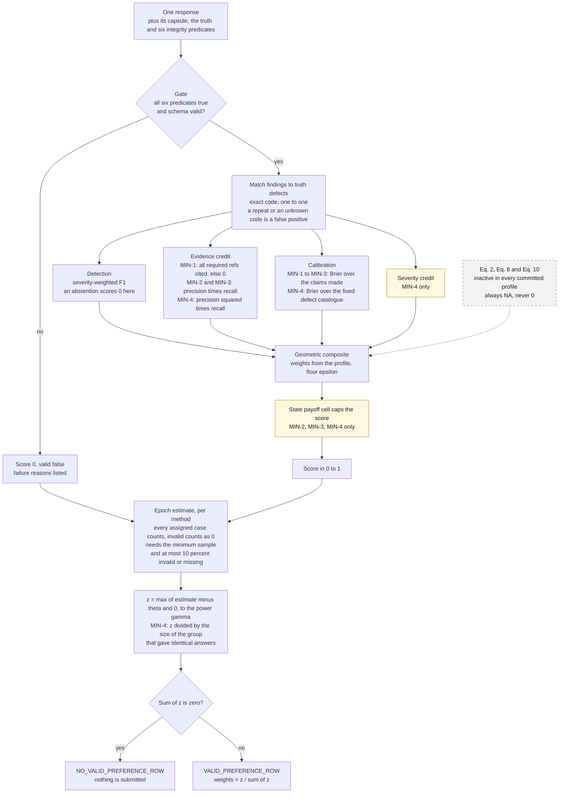

# Diagram 3: Scoring pipeline

> From one answer to a score, from many scores to a preference row. Every number comes from the
> committed profile; the scorer has no defaults.

Quick links: [diagram index](README.md) | [profile application](../protocol/profile-application.md) | [wire rules](../protocol/wire-rules.md) | [previous](02-submission-lifecycle.md) | [next: contest window timeline](04-contest-window-timeline.md)



Dashed grey is inactive. Yellow steps exist only under the newer profiles
(`IC-FIRST-LIGHT-MIN-2` to `-4`, `GRA-RELEASE-MIN-4`), which are committed and active on no weight
path. The profile in use on the weight path is `IC-FIRST-LIGHT-MIN-1`; `GRA-W03-3` is the committed profile of the release class.

## The numbers behind the boxes

| Box | Value under `IC-FIRST-LIGHT-MIN-1` | Source |
|---|---|---|
| Composite weights | detection 0.60, evidence 0.25, calibration 0.15 | `src/sn87_provenonce/profiles/IC-FIRST-LIGHT-MIN-1.json` |
| Epsilon floor | 0.000001 | same file |
| Threshold theta, sharpness gamma | 0.60 and 2 | same file |
| Minimum assigned cases | 12 (8 `stale_authority`, 4 `fresh_review`; 4 `incomplete` are diagnostics) | same file |
| Failure ceiling | 0.10 raw invalid or missing | same file |
| Severity weights | LOW 0.25, MEDIUM 0.50, HIGH 1.00 | same file |

Under `IC-FIRST-LIGHT-MIN-3` a window assigns 24 scored cases against a minimum of 22, so it
absorbs 2 reference failures. Under `IC-FIRST-LIGHT-MIN-4` it assigns 40 against a minimum of 36
([ADR-0020](../architecture/ADR-0020-contest-windows-and-window-sizing-profile.md),
[ADR-0022](../architecture/ADR-0022-constant-bound-fixed-outcome-profile.md)).

## A worked example (arithmetic only)

The preference row turns estimates into weights. Suppose two methods have estimates 1.0 and 0.8
under `IC-FIRST-LIGHT-MIN-1` (theta 0.60, gamma 2):

```text
z(method A) = max(1.0 - 0.60, 0) ** 2 = 0.16
z(method B) = max(0.8 - 0.60, 0) ** 2 = 0.04
weights     = 0.16 / 0.20 = 0.8 and 0.04 / 0.20 = 0.2
```

This shows the rule, not a result. An estimate at or below theta gets z = 0. If every z is 0 the
row is `NO_VALID_PREFERENCE_ROW`. The public demo (`uv run sn87-provenonce demo`) prints real
rows for three public fixtures: a correct finding scores 1, and a correct abstention on an
incomplete capsule scores only the floor, 1e-6, under this profile.

## Where the code is

| Stage | Function | File |
|---|---|---|
| Gate, matching, dimensions, composite | `score_response`, `geometric`, `calibration`, `evidence_credit` | `src/sn87_provenonce/scoring.py` |
| State payoff | `state_payoff_score` | `src/sn87_provenonce/scoring.py` |
| Fixed-outcome path (rules version 4) | `_score_fixed_outcome`, `fixed_outcome_calibration`, `severity_credit` | `src/sn87_provenonce/scoring.py` |
| Epoch estimate | `epoch_estimate` | `src/sn87_provenonce/scoring.py` |
| Preference row | `preference_row` | `src/sn87_provenonce/scoring.py` |
| Identical-answer groups | `redundancy_groups` | `src/sn87_provenonce/redundancy.py` |
| Non-scoring flags | `observation_flags` | `src/sn87_provenonce/flags.py` |

## Known limits of the scoring on the weight path

These are stated in [LIMITATIONS.md](../../LIMITATIONS.md) and not hidden here: a correct
abstention scores the floor (item 16), the bound on constant answers exists only in the inactive MIN-4 profiles (item 18), evidence
credit is all or nothing (item 3), and the public baseline ties the reference methods (item 8).
The newer profiles go further on paper and are not active.
