# Diagram 4: Contest window timeline

> The order of events in one contest window, which side publishes what, and which deadline each
> step has. Read left to right.

Quick links: [diagram index](README.md) | [contest windows protocol](../protocol/contest-windows.md) | [ADR-0023](../architecture/ADR-0023-opening-block-seed-truth-commitment-and-reveal-deadline.md) | [previous](03-scoring-pipeline.md) | [next: trust chain](05-trust-chain.md)

A contest window is a bounded period in which miners answer fresh generated capsules. The whole
schedule is committed first, so a seed cannot be chosen after seeing answers. Times below are
fields of the committed schedule: `opens_at`, `closes_at` and `reveal_deadline`.

```mermaid
flowchart LR
    subgraph BEFORE["Before any window opens"]
        C0["init-master<br/>master seed, mode 0600"]
        C1["commit<br/>seed commitment, salted spec commitment,<br/>schedule commitment, reveal_deadline"]
        C2["Anchor the commitments file<br/>in an outside, dated channel<br/>(operator duty, not done by the tool)"]
    end

    subgraph OPEN["opens_at to closes_at"]
        O1["Opening block exists<br/>first block at or after opens_at<br/>at least 12 blocks behind the head<br/>(protocol 0.2)"]
        O2["open<br/>seed = HMAC of pre-seed and block<br/>build capsules<br/>fix truth, publish truth_commitment"]
        O3["query<br/>capsules go to miners<br/>each request carries window_commitments"]
    end

    subgraph AFTER["After closes_at"]
        A1["Scores only<br/>per-method estimate, eligibility, cost"]
        A2["reveal<br/>pre-seed, block, seed, spec<br/>by reveal_deadline (at most 7 days after close)"]
        A3["publish-truth<br/>per-case truth and salt<br/>only under the explicit policy flag"]
        A4["verify and verify-bundle<br/>anyone recomputes commitments<br/>and regenerates every capsule"]
    end

    C0 --> C1 --> C2 --> O1 --> O2 --> O3 --> A1 --> A2 --> A3 --> A4
    A2 -.->|"no reveal by the deadline"| OD["REVEAL_OVERDUE flag<br/>in the published index"]

    classDef pub fill:#e8f1fb,stroke:#1f5fa8,color:#1a1a1a
    classDef warn fill:#fff8e1,stroke:#b58900,color:#1a1a1a
    class C1,O2,A1,A2,A3,A4 pub
    class C2,OD warn
```

## What is published at each stage

| Stage | Published | Withheld |
|---|---|---|
| Commit | commitments, window times, profile id and commitment, generator id | seeds, family mix, truth |
| Open | capsules (to miners), cases commitment, truth commitment, opening block | family, track and truth of each case |
| Close | scores only: estimate and eligibility per method, cost | agreement with truth, confusion tables, family tables, reference failures |
| Reveal | seed (and pre-seed and block for 0.2) and the specification | master seed, other windows' seeds |
| Truth publication | per-case truth with its salt, for a closed and revealed window, under the policy flag | nothing more |

## Guards: what the tool refuses and when

| Phase | Refused when | Error |
|---|---|---|
| `commit` | any window has already opened | `COMMIT_AFTER_OPEN` |
| `commit` | a window id or seed was used before | `WINDOW_OR_SEED_REUSED` |
| `open` | before `opens_at` | `OPEN_BEFORE_WINDOW` |
| `open` | after `closes_at` | `OPEN_AFTER_CLOSE` |
| `reveal` | before `closes_at` | `REVEAL_BEFORE_CLOSE` |
| `publish-truth` | before close, before reveal, or without the policy flag | `TRUTH_PUBLICATION_BEFORE_CLOSE`, `TRUTH_PUBLICATION_BEFORE_REVEAL`, `TRUTH_PUBLICATION_NOT_AUTHORIZED` |
| `publish-truth`, `verify`, results | the truth file hashes differently from the one published at open | `TRUTH_HASH_DIFFERS_FROM_OPEN` |
| results phase (`scripts/contest_window.py`) | before close | `RESULTS_BEFORE_CLOSE` |
| schedule | a reveal deadline before close, or more than 7 days after it | `REVEAL_DEADLINE_BEFORE_CLOSE`, `REVEAL_DEADLINE_TOO_LATE` |

The guards check the clock the operator supplies. They protect against operator mistakes, not
against an operator who falsifies the clock.

## Protocol 0.1 and 0.2

| | 0.1 | 0.2 |
|---|---|---|
| Seed | from the master seed alone | also mixes in the opening block hash, so no one knows the instances before that block exists (see ADR-0023 for limits) |
| Truth | computed after close | fixed at open, and its salted hash is sent in every request |
| Reveal | promised at close; the windows of the first schedule closed with commitments only; the reveal of the first schedule is not yet published | `reveal_deadline` per window, at most 7 days after close |
| Status | readable and verifiable | tooling committed, no schedule deployed ([ADR-0023](../architecture/ADR-0023-opening-block-seed-truth-commitment-and-reveal-deadline.md)) |

The block hash removes advance knowledge only. The operator still builds the instances and holds
the reference executors.

## Where the code is

`scripts/contest_window.py` (phases, guards, `find_beacon_block`, `FINALITY_DEPTH`,
`MAX_REVEAL_DELAY`), `scripts/contest_results.py` (per-window results). Walk through a committed
demo window yourself in the [contest windows quickstart](../quickstart/contest-windows.md), and
recompute a closed window from its published files with
[reproduce a window](../guides/reproduce-a-window.md), which lists what it could not check.
