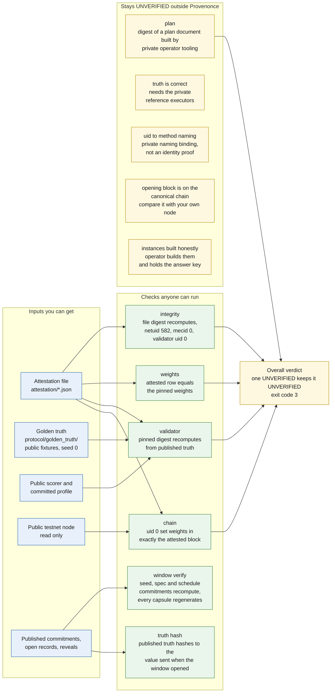

# Diagram 5: Trust and verification chain

> What each check depends on, what you can run yourself, and what stays UNVERIFIED outside
> Provenonce.

Quick links: [diagram index](README.md) | [attestation README](../../attestation/README.md) | [reviewer test guide](../guides/reviewer-test-guide.md) | [previous](04-contest-window-timeline.md) | [next: weight flow](06-weight-flow.md)

Every check ends in one of three words. **PASS**: it ran and the claim holds. **FAIL**: it ran and
the claim does not hold. **UNVERIFIED**: it could not run here, and nothing is claimed.

## Reading the chain

| Check | Depends on | Result today | Command |
|---|---|---|---|
| integrity | the attestation file only | PASS | `scripts/verify_attestation.py` |
| validator | golden truth, public scorer, committed profile, the staging validator | PASS for the attested seed | `scripts/verify_attestation.py`, `scripts/staging_subnet.py` |
| weights | the attestation file | PASS | `scripts/verify_attestation.py` |
| chain | the public testnet node (needs network) | PASS | `scripts/verify_attestation.py` |
| plan | private operator tooling and unpublished files | UNVERIFIED | not runnable here |
| window verify | commitments and reveal files | PASS or FAIL per window | `scripts/contest_window.py --phase verify` |
| truth hash | the truth file and the open record | PASS or FAIL per window | `scripts/contest_window.py --phase verify` |

The README shows a real run of the verifier, generated from the code, in
[Verify the chain proof yourself](../../README.md#verify-the-chain-proof-yourself).

## What a PASS does not prove

- A validator-check PASS shows the scorer reproduces the attested digest from the published truth.
  It does not show the truth is right, and it says nothing about hidden instances
  ([ADR-0021](../architecture/ADR-0021-published-truth-for-public-fixtures.md)).
- A truth-hash PASS shows the truth was not changed after the window opened. It does not show the
  truth is correct, because the reference executors stay private.
- A commitments file proves order only if you know when it was published. The tool produces the
  value to anchor; it does not anchor it.
- The block record is checked offline for the time rule (`parent_time < opens_at <= time`). The
  tool does not read a chain to show the block is canonical.
- A window result record carries a digest, not a signature. The digest detects accidental edits;
  it cannot tell the validator's record from one written by someone else with a correct digest
  ([admission.md](../protocol/admission.md), "Trust boundary of the window result").

## Where the code is

`scripts/verify_attestation.py`, `scripts/chain_read.py` (read-only chain client),
`scripts/golden_truth.py`, `scripts/staging_subnet.py`, `scripts/contest_window.py`,
`scripts/render_verifier_output.py`. What each check proves is spelled out in
[attestation/README.md](../../attestation/README.md).
