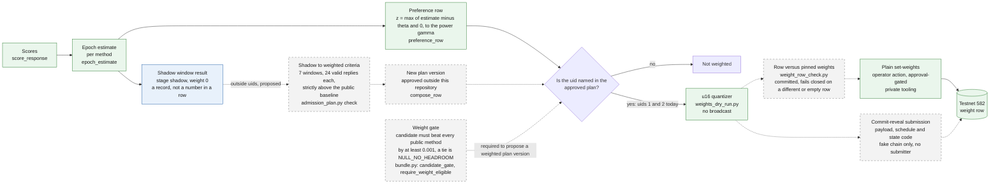

# Diagram 6: Weight flow

> How scores become, or do not become, a weight row on the chain. Solid lines are the path in use
> on testnet 582. Dashed grey boxes are committed or proposed and inactive.

Quick links: [diagram index](README.md) | [admission](../protocol/admission.md) | [shadow cohort](../guides/shadow-cohort.md) | [second-validator readiness](../protocol/second-validator-readiness.md) | [previous](05-trust-chain.md) | [next: trust boundary](07-trust-boundary.md)

## What is in use, what is not

| Box | State | Why |
|---|---|---|
| Score, epoch estimate, preference row | In use | The scorer runs on every weight path and every shadow window. |
| Approved plan | In use | It names the weighted uids. Today those are uids 1 and 2, both operated by Provenonce. |
| u16 quantizer | In use | Shared by the plain path and the commit-reveal code. It never broadcasts. |
| Row versus pinned weights | Committed; not shown to run on the live path | `weight_row_check.py`. A row to be built or sent is compared with the weights pinned by the recomputed validator receipt; a missing, empty, malformed, out-of-range or different row stops the step (`WeightRowMismatch`). The commit-reveal runner and the plan check in this repository call it. Whether the operator's own weight-setting tooling calls it is not shown here, and it is not deployed. It is a separate check from the weight gate below, which is inactive. |
| Plain set-weights | In use, operator only | Needs the validator's own hotkey, permit and an explicit approval. The tooling is not in this repository. |
| Shadow result | Tooling committed; operator service, not verifiable from this repo; allowlist empty. Outside the weight path | Published with `weight: 0`. The shadow code reads the score summary only and has no path to the quantizer ([admission.md](../protocol/admission.md)). |
| Weight gate | Inactive | Committed and tested. A weighted plan version cannot be proposed without an eligible gate verdict (`admission_plan.py`, a check on a `PROPOSED` version). It is wired into no weight write and no live weight path (`LIMITATIONS.md`, item 17). |
| Shadow to weighted criteria | Proposed, cannot be met today | The strict baseline rule ties under today's windows (`LIMITATIONS.md`, item 20). |
| New plan version | Inactive | Needs an approval record made outside this repository. Nothing in this tree reads it. |
| Commit-reveal submission | Not run on any chain | Tested against a fake chain. The plain path refuses a commit-reveal target. |
| Redundancy groups under MIN-4 | Inactive | Part of a profile that is committed and active on no weight path. |

## Why a row can be empty

If no estimate is above theta, the sum of z is 0 and the result is `NO_VALID_PREFERENCE_ROW`.
Nothing is submitted. A quantized row that would break the chain's limits is refused with a named
error, for example `TARGET_MINIMUM_REQUIRES_UNSUPPORTED_PREFERENCES` or `QUANTIZATION_DROPS_BELOW_MINIMUM`
(`src/sn87_provenonce/weights_dry_run.py`).

## Where the code is

| Stage | File |
|---|---|
| Estimate and preference row | `src/sn87_provenonce/scoring.py` |
| Weight gate | `src/sn87_provenonce/bundle.py` |
| Quantizer | `src/sn87_provenonce/weights_dry_run.py` |
| Criteria, plan versions, `compose_row` | `scripts/admission_plan.py` |
| Commit-reveal payload and fake chain | `scripts/commit_reveal_weights.py`, `scripts/commit_reveal_fake_chain.py` |
| Row check | `scripts/weight_row_check.py` |
