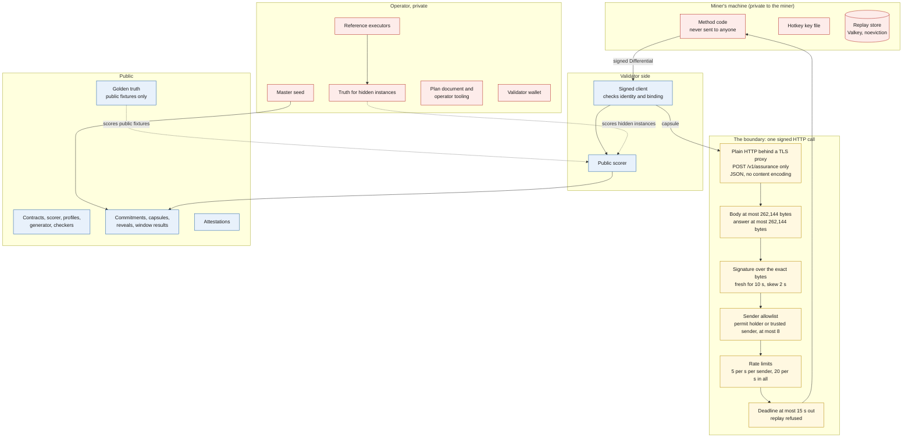

# Diagram 7: Sandbox and trust boundary

> What is private, what is public, and what sits between a validator and a miner's code.

Quick links: [diagram index](README.md) | [ADR-0005](../architecture/ADR-0005-signed-http-and-replay-boundary.md) | [miner guide, who may send](../guides/miner-guide.md#who-may-send-the-sender-allowlist) | [previous](06-weight-flow.md) | [next: a miner's first day](08-miner-first-day.md)

SN87 has no sandbox for miner code. A miner runs its own method on its own machine and returns
bytes. The validator never runs that code. The boundary is a signed HTTP call, behind your own TLS proxy, with strict limits,
and the scorer sees only the answer it receives.

## Who can see what

| Item | Miner | Validator | Public |
|---|---|---|---|
| Your method code | yes | no | no |
| Your hotkey key file | yes | no | no |
| Capsule you were sent | yes | yes | yes, published with the window |
| Your reply: state, finding codes, severities, evidence references, confidence | yes | yes | yes, after close |
| Your reply: free text (method, rationale) | yes | yes | no |
| Truth of a hidden instance | no | operator only | no, until a window is revealed and truth is published under the policy flag |
| Truth of the committed public fixtures | yes | yes | yes (`protocol/golden_truth/`) |
| Master seed, wallet, plan document | no | operator only | no |
| Scorer, profiles, generator | yes | yes | yes |

Do not send anything in a reply that you are not willing to see published
([shadow cohort page](../guides/shadow-cohort.md)).

## What the boundary does and does not give you

- **Does:** keeps unsigned, replayed, oversized, late and unauthorised requests away from your
  method, and keeps anything the validator does not need (your code, your key) on your side.
- **Does not:** isolate your method from your own machine. You run it with your own privileges.
  Treat a capsule as untrusted input.
- **Does not:** prove who runs a hotkey. A hotkey signs; nothing shows what process is behind it.
- **Does not:** make the baseline separate from the truth by process isolation. The separation
  tests check the import graph and a run with evaluator-only modules blocked. They are not a
  sandbox ([implementation status](../protocol/implementation-status.md)).

## Where the code is

| Layer | File |
|---|---|
| Request limits, deadline, envelope | `src/sn87_provenonce/pilot/server.py` |
| Signature, freshness, replay store | `src/sn87_provenonce/pilot/transport.py` |
| Sender allowlist and rate limits | `src/sn87_provenonce/pilot/sender_policy.py` |
| Client checks | `src/sn87_provenonce/pilot/client.py` |
| Launcher and options | `src/sn87_provenonce/miner_node/launcher.py` |
