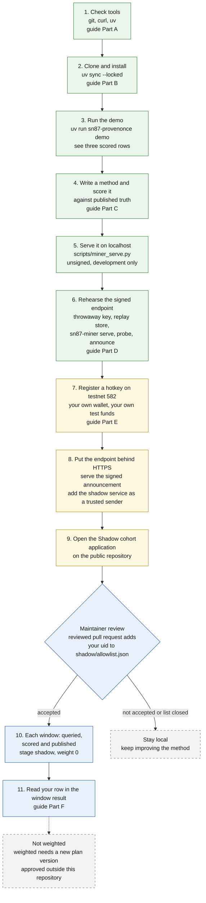

# Diagram 8: A miner's first day

> From a fresh clone to a published, unweighted record, and which steps are yours to take
> outside this repository. It mirrors the [miner guide](../guides/miner-guide.md).

Quick links: [diagram index](README.md) | [miners page](../MINERS.md) | [start here](../guides/start-here.md) | [previous](07-trust-boundary.md)

The guide takes about 75 minutes. It does not end at a score on testnet 582, because that needs
your uid on the shadow allowlist and a window to have closed. No outside uid is known to be
scored by this repository's tooling.

Green steps are rehearsals on your own computer: they need no wallet and no account and send
nothing to a chain. Yellow steps are yours to do with your own tools; this repository performs
none of them. Blue steps involve the maintainers and the published record. Grey is not available
today.

## The same path as a table

| Step | You do | You should see | Where |
|---|---|---|---|
| 1 | Check `git`, `curl`, `uv` | version lines | [guide Part A](../guides/miner-guide.md#part-a-requirements-and-platform-policy) |
| 2 | `git clone`, `uv sync --locked` | packages installed from `uv.lock` | [guide Part B](../guides/miner-guide.md#part-b-install-and-run-the-public-demo) |
| 3 | `uv run sn87-provenonce demo` | three rows: a finding scores 1, a clear scores 1, an abstention scores the floor | [README quickstart](../../README.md#60-second-quickstart) |
| 4 | Write a function with the same shape as `src/sn87_provenonce/miners/witness_ic.py` and score it | your own rows against published truth | [guide Part C](../guides/miner-guide.md#part-c-write-a-method-serve-it-locally-score-it) |
| 5 | `uv run python scripts/miner_serve.py --role candidate --port 8787` | `curl http://127.0.0.1:8787/health` answers | [README](../../README.md#run-a-miner) |
| 6 | Run `sn87-miner serve`, `probe`, `announce` with a throwaway key | a `probe` that passes; a signed announcement that verifies | [guide Part D](../guides/miner-guide.md#part-d-the-signed-endpoint-the-probe-and-the-announcement) |
| 7 | Register a hotkey on 582 with your own wallet | your uid | [guide Part E](../guides/miner-guide.md#part-e-registration-and-test-funds-on-582) |
| 8 | Serve behind TLS; add `--trusted-sender` for the shadow service | the address is shown on the shadow page | [shadow cohort](../guides/shadow-cohort.md) |
| 9 | Open the issue form "Shadow cohort application" | a public issue | [shadow cohort](../guides/shadow-cohort.md) |
| 10 | Wait for review and for a window to close | a result with `weight: 0` | [window results](../protocol/window-results.md) |

## If something goes wrong

| You see | Do this |
|---|---|
| `SENDER_NOT_PERMITTED` (403) from your endpoint | The sender is not a permit holder. Add the shadow service address with `--trusted-sender`. |
| `REMOTE_REJECTED_403` in a probe | You probed with a throwaway key. Start `serve` with `--probe-hotkey SS58` and run `probe` with `--probe-hotkey-keyfile`. |
| `MINER_REJECTED_ENVELOPE` | Your miner does not know a field of the request. Update `sn87-miner`. |
| Window recorded you as unavailable | A timeout, refusal or rejection. It is not an integrity failure. Read the error table. |

The full table is [Part G of the miner guide](../guides/miner-guide.md#part-g-troubleshooting-by-error-code).
