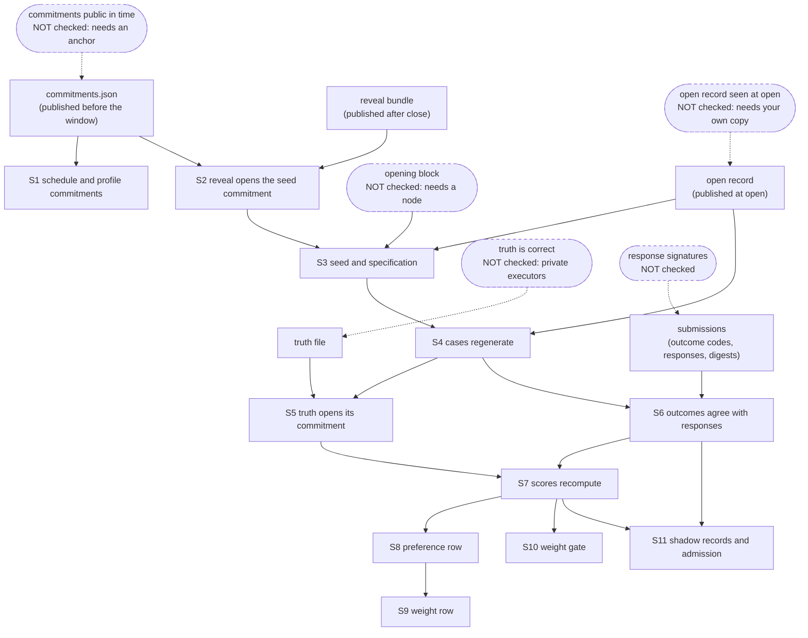

# Reproduce a contest window

**Status.** Testnet 582 only, alpha ([LIMITATIONS.md](../../LIMITATIONS.md)). This page is for a
second party who has been given the published files of one closed contest window and wants to
check that the numbers follow from them. It sets no weight, signs nothing and reads no chain.

## What the kit does

`scripts/reproduce_window.py` takes the files a closed window publishes and recomputes, step by
step, the claim the publisher makes. It prints `PASS`, `FAIL` or `UNVERIFIED` for each step with
the reason, then a closing statement of exactly what was reproduced and what was not.

It does not ask you to trust the publisher's scores. It does ask you to hold the files: if a file
is missing, the steps that need it say `UNVERIFIED`, never `PASS`.

## The files it needs

| File | What it is | Published |
|---|---|---|
| `commitments.json` | The schedule commitments: one seed commitment and one specification commitment per window, and the profile commitment | Before the windows open |
| `window_<id>.capsules.json` | The open record: the capsules the miners got, the cases commitment, the truth commitment and the opening block | When the window opens |
| `reveal-bundle.json` | The reveal bundle: the pre-seed, the opening block and the specification of each window | After the window closes |
| `window_<id>.truth.json` | The published truth of every case, with the salt that opens the truth commitment | After the window closes, only under the `truth_derived` policy ([window-results.md](../protocol/window-results.md)) |
| `window_<id>.submissions.json` | Each miner's outcome code per query, its stage, uid and hotkey, the response it gave (free text removed, see below) and the response digest | With the window result |
| `window_<id>.json` | The window result: scores, agreement, failures | After the window closes |
| `window_<id>.derived.json` | The preference row, the weight row, the weight gate verdicts and the shadow records with the admission verdict | With the window result |

The first four are the files the [contest protocol](../protocol/contest-windows.md) already
publishes. The last three are written by the publisher from those files; the kit recomputes each
of them. A fixture with all seven is in `examples/window-repro-fixture/`.

Today these files exist only in the synthetic fixture; no live window has published them.

## Run it

If you already have a clone of the public repository with its packages installed, skip to the
last block of this section. Otherwise:

```bash step id=goto-home silent
cd ~
```

```bash step id=clone
git clone https://github.com/provenonce-ai/sn87-provenonce-public
```

```text expect
Cloning into 'sn87-provenonce-public'...
...
```

```bash step id=enter-repo silent
cd sn87-provenonce-public
```

```bash step id=install timeout=900
uv sync --locked
```

```text expect
...
re: Installed \d+ packages? in .*
...
```

Then run the kit on the committed fixture:

```bash step id=reproduce exit=3
uv run python scripts/reproduce_window.py --dir examples/window-repro-fixture
```

```text expect
Reproduction of window demo-repro-0001 from examples/window-repro-fixture
re: \[PASS\] S1 schedule commitments: .*
re: \[PASS\] S2 reveal opens the seed commitment: .*
re: \[PASS\] S3 seed from pre-seed and opening block: .*
re: \[PASS\] S4 cases regenerate to the cases commitment: .*
re: \[PASS\] S5 truth opens the truth commitment in the open record: .*
re: \[PASS\] S6 outcome codes agree with published responses: .*
re: \[PASS\] S7 scores recompute under the named profile: .*
re: \[PASS\] S8 preference row recomputes: .*
re: \[PASS\] S9 weight row recomputes: .*
re: \[PASS\] S10 weight gate verdict recomputes: .*
re: \[PASS\] S11 admission verdict recomputes: .*
re: \[UNVERIFIED\] B opening block is canonical: .*
re: \[UNVERIFIED\] A commitments public before the window opened: .*
re: \[UNVERIFIED\] O open record is the one seen at open: .*
re: \[UNVERIFIED\] T truth correct for capsule-computed families: .*
re: \[UNVERIFIED\] G miner response signatures: .*

...
UNVERIFIED
```

The exit code is 0 when every step passes, 3 when none fails but some are `UNVERIFIED`, and 1 when
any step fails. Line `G` (signatures) is always `UNVERIFIED`, so in practice 0 cannot be reached:
a clean run exits 3, and supplying outside evidence turns lines `B`, `A` and `O` into `PASS`
without changing that.

**What a pass means.** Every file comes from the operator. A pass means the files agree with
each other and with the public code. An operator who controls every file can produce a set that
passes S1 to S11. Only outside anchoring (lines `B`, `A`, `O`), the miners' signatures and the
private executors rule that out, and the kit cannot supply those. The closing claim says so and
starts "Internally consistent, operator-supplied files".

## What each step checks, and what it depends on

| Step | Recomputes | Depends on |
|---|---|---|
| S1 | The schedule commitment from the committed rows; the profile commitment against the profile document in your checkout | `commitments.json`, your copy of the code |
| S2 | The revealed pre-seed (protocol 0.2) or seed (0.1) against the seed commitment | S1's file, the reveal bundle |
| S3 | The window seed from the pre-seed and the opening block; the specification against its commitment; that the block is the first at or after opening, by its two timestamps | S2, the open record |
| S4 | The cases from the seed; they must equal the published capsules and the cases commitment | S3 |
| S5 | The salted truth commitment from the published truth; it must be the one written in the open record. That binds the truth only if the open record is the one seen when the window opened (line O) | S4, the truth file |
| S6 | Each miner's outcome code against what it published (only once S4 has passed) (a `VALID` code needs a response that passes the response schema and matches its digest; a failed reply must fail; a timeout publishes none) and the baseline's responses against the public baseline code | S4, the submissions file |
| S7 | The whole window result under the profile the schedule commits to (a result scored under any other profile fails) | S5, S6 |
| S8 | The preference row from the estimates of the weighted identities. Identity, stage, uid and hotkey come from the submissions and must equal the derived record | S7 |
| S9 | The u16 weight row from the preference row; no shadow uid may be in it | S8 |
| S10 | The baseline-headroom gate verdicts | S7 |
| S11 | Each shadow window record (counts, score, public baseline score) and the criteria verdict | S6, S7 |



Read the chain from the top. An arrow means "the step needs the one above to hold". A dashed box
is something the files cannot show; the kit lists it as `UNVERIFIED` rather than skipping it.

## Four levels, and which one this kit touches

The words below are used the same way across this repository. A result at one level says nothing
about the next.

| Level | What it is | This kit |
|---|---|---|
| Local example | You run the miner and the scorer on fixtures or a `demo-` window on your own machine | Yes: the committed fixture is one, and the kit recomputes all of it. The result is a test of the kit, not of any miner |
| Shadow participation | An outside uid is queried with the same fresh capsules, scored with the public scorer and published with weight 0 | Partly: S6 and S11 check that the published shadow records follow from the published responses. It cannot show the uid belongs to someone independent of the operator |
| Independent validation | A second validator builds its own challenges, takes its own truth and scores | No. The kit re-runs the operator's cases and the operator's truth. A match shows the operator's numbers follow from the operator's files; it is not a second opinion on the truth ([second-validator-readiness.md](../protocol/second-validator-readiness.md)) |
| Weighted activity | A weight row set on a chain for a uid | No. S9 recomputes the row from the scores. Nothing checks that any row was ever set |

## What this cannot show

* **The opening block.** It is an input to the seed. S3 checks the block's two timestamps against
  the opening time and that the seed follows from its hash. Whether the block exists, and is the
  first one at or after opening, needs a node: pass `--expect-block NUMBER:0xHASH` with what your
  own node says. A record marked `MANUAL` was typed in by the operator, not read from a node.
* **Publication time.** The commitments prove order only if you know when they were public. Pass
  `--commitments-seen-at ISO` if you hold a dated release, repository commit or log that shows it.
* **Truth for capsule-computed families.** The truth is computed by private reference executors. S5 shows the truth
  you were given is the truth written in the open record, and that binds it only if the open
  record is the one seen when the window opened: an operator who re-seals the truth and the open
  record together passes S5. Pass `--open-record-seen FILE` with the `window_commitments` a miner
  recorded in a signed request (or another copy you saw at open) to check it. It does not show
  that truth is right. Where the executors are installed, `--use-reference` recomputes it; the public tree does not have them.
* **Signatures.** A response digest is the digest of the published form of the reply. It shows
  which bytes were meant, not that the miner signed them. The kit does not verify transport
  signatures.
* **Unavailable outcomes.** A `TIMEOUT`, `NOT_QUERIED_*`, `RESPONSE_LATE` or connection outcome
  has no reply, so there is nothing in the files to check it against. The kit checks only that no
  reply is published with it. Whether the miner really failed to answer cannot be falsified from
  files; it needs the validator's logs or the miner's own.
* **Free text.** The `method` and `rationale` text of a reply is not published
  ([shadow-cohort.md](shadow-cohort.md)). The submissions file carries the constant
  `NOT_PUBLISHED` in each of those fields, which keeps the reply valid and changes no score, and
  the digest is of that published form.
* **Scoring profile.** S7 requires the result to be scored under the profile the schedule commits
  to. A window the operator also scored under another profile is not covered by this kit.
* **Independent participation.** The files do not say whether miners are independent of each other
  or of the operator.
* **Private inputs.** The kit never reads the master seed, the private truth file or any sealed
  run state. If a window used them in a way the published files do not cover, the step that
  depends on them says `UNVERIFIED`.

## Supplying outside evidence

```text
uv run python scripts/reproduce_window.py --dir PUBLISHED_DIR \
    --expect-block NUMBER:0xHASH_FROM_YOUR_NODE \
    --commitments-seen-at ISO_TIME_WITH_ZONE --open-record-seen FILE_YOU_SAVED_AT_OPEN
```

The time needs a zone (`2026-11-09T00:00:00Z`). With these supplied, lines `B`, `A` and `O` become
`PASS` (or `FAIL` if your evidence disagrees). Line `G` stays `UNVERIFIED`, and `T` stays so
unless you have the private executors, so the run exits 3 and says why.

## About the fixture

`examples/window-repro-fixture/` is synthetic. The window id has the `demo-` prefix, so its master
seed is public by construction and its instances are never reused. The opening block is a fake,
typed in and marked `MANUAL`. The hotkeys are placeholders. It has six methods: the public
`approval_witness` (weighted stage), a second weighted method, three shadow uids (one clean, one
with a timeout, a malformed reply, a reply for another capsule and two queries never sent, one with
an integrity failure) and the public-contract baseline (the three shadow uids are 5, 6 and 7). The files are produced by a private
generator and a test checks that the committed files are what it makes. In this fixture two of the
three shadow uids fail the proposed admission criteria and one passes; that is a property of the
synthetic answers, not a result.
